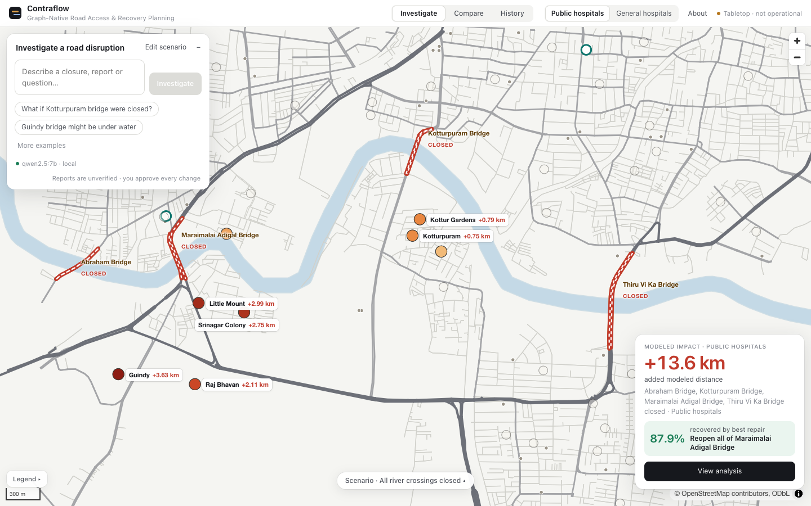
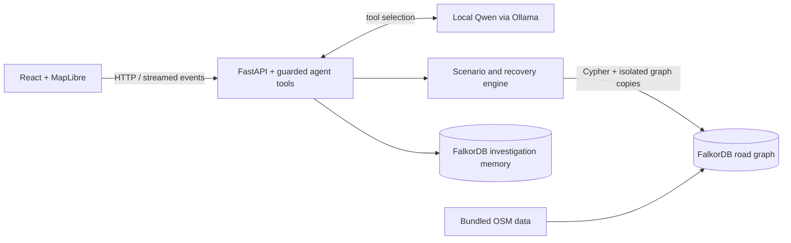

# Contraflow

**Graph-native road-access investigation and recovery planning.**

Graph Hacks 2026 · Track 01 — Agents That Act on Connected Data

[Live application](https://abhiks-macbook-air.tail9ad3eb.ts.net) · [Watch the demo](https://youtu.be/Engunbu7ytc)

Contraflow is a tabletop planning sandbox for Chennai’s Adyar river corridor. It uses real OpenStreetMap roads to explain why closing one prominent bridge changes no modeled routes, while closing another adds nearly 12 km across neighborhood routes. A local Qwen agent investigates reports, checks planning constraints and compares recovery options using FalkorDB. A person approves changes.



> **A modeled access metric, not emergency advice.** Distances are sums of shortest directed road routes from neighborhood anchors to their nearest assistance point. They do not measure evacuation capacity, travel time, flood conditions or safety. [Limitations](docs/LIMITATIONS.md)

## Try it

1. Open **Compare** to contrast the bridge closures below.
2. Close **all crossings**, then open **View analysis** to inspect the recovery ranking and query evidence.
3. Ask **Investigate**: “Saidapet bridge may be blocked.” Review the streamed tool steps, affected neighborhoods and proposed action before applying it.
4. Add an emergency reservation and compare the revised recommendation. Open the **case file** and **Test assumptions** to inspect its evidence and sensitivity.

The live application runs on the owner’s Mac through Tailscale Funnel; availability depends on the machine being awake and connected. Qwen investigations typically take around 16 seconds in recorded local benchmarks. If Ollama is unavailable, a clearly labeled deterministic planner uses the same guarded tools.

## Capabilities

- **Graph-computed scenarios:** directional closures, road reversals, nearest assistance points and independently evaluated recovery candidates.
- **Constrained investigations:** ambiguity clarification, direction and intent guards, emergency reservations, stale-proposal rejection and human approval.
- **Traceable evidence:** Cypher, timings and route explanations; graph-backed investigation memory and exportable case files distinguish reports, findings, assumptions and decisions. [Investigation view](docs/img/investigation.png).
- **Assumption testing:** compare assistance-point rules and bounded alternative scenarios. Seven MCP tools also expose investigations to external agents without applying road changes.

## Architecture and graph model



The road model has **3,483 junctions, 8,458 directed segments and 45 neighborhood anchors**. `(:Zone)-[:ANCHORED_AT]->(:J)` connects neighborhoods to roads; `(:J)-[:ROAD {eid, len, oneway}]->(:J)` stores directed movement. Crossings group directional carriageways and their road IDs. Assistance points connect to a zero-length virtual hub for each selection rule: four public hospitals (**B**) or 37 general hospitals (**A**).

FalkorDB computes production routes, scenario effects and candidate evaluations. NetworkX supports offline model preparation and independent correctness checks. The separate memory graph connects investigations, reports, places, findings, assumptions, proposals and human decisions. [Full schema and algorithms](docs/MODEL.md)

**Nearest-assistance access for every anchor**, directly from [`contraflow/engine.py`](contraflow/engine.py):

```cypher
MATCH (z:Zone)-[:ANCHORED_AT]->(a:J), (h:J {id: $hub})
CALL algo.SPpaths({sourceNode: a, targetNode: h, relTypes: ['ROAD'], weightProp: 'len'})
YIELD path, pathWeight
WITH z, pathWeight, relationships(path) AS rs
RETURN z.id, pathWeight, [r IN rs WHERE NOT coalesce(r.virtual, false) | r.eid], startNode(rs[size(rs) - 1]).id
```

Here `$hub` is `__HUB_B__` for the public-hospital rule. Every scenario uses `GRAPH.COPY`, changes only its copy, runs the access query and deletes the copy. `GRAPH.COPY` and `GRAPH.DELETE` are database commands; closures use this Cypher on the copy:

```cypher
UNWIND $ids AS i MATCH ()-[e:ROAD {eid: i}]->() DELETE e
```

Recovery candidates are evaluated on the same canonical scenario used by the authoritative application endpoint. Candidates that cut off neighborhoods are flagged harmful and ranked last; disconnected anchors are reported separately from distance changes.

## Verified modeled results

Recorded FalkorDB computations, **rule B**, baseline aggregate **79.58 km**, 45 anchors:

| Scenario | Additional modeled distance |
|---|---:|
| Thiru Vi Ka Bridge closed | **0.00 km** |
| Maraimalai Adigal Bridge closed | **11.92 km** |
| All seven crossing carriageways closed | **13.55 km** |
| Reopen Maraimalai Adigal from all closed | **11.92 km recovered · 87.9%** |

No anchor is cut off in these presets. Thiru Vi Ka is absent from the selected shortest routes to these assistance points; zero change does not mean the bridge is unimportant. Reserving Maraimalai Adigal for emergency use excludes it from public recovery options, changing the recommendation.

[Recorded demo results](results/demo_run.json) · [Evaluation evidence and reproduction](results/README.md)

## Quick start

Requires a running Docker engine and Docker Compose. For the local LLM, install [Ollama](https://ollama.com), start its service and run `ollama pull qwen2.5:7b` once (about 4.7 GB). The deterministic planner works without Ollama.

```bash
git clone https://github.com/AbhikRao/Contraflow.git
cd Contraflow
docker compose up --build
```

Open [localhost:8000](http://127.0.0.1:8000). Use `docker-compose` if your installation provides the standalone command. The database remains on the Compose network; only the application is published, on localhost. The container uses `host.docker.internal` to reach host Ollama. If your Docker engine uses another host address, see [development setup](docs/DEVELOPMENT.md).

Road data is bundled; no live OSM download or paid API is required. Named volumes preserve graph data and investigation memory across container recreation. `docker compose down -v` deletes those volumes.

## Documentation

[Model and Cypher](docs/MODEL.md) · [Architecture](docs/ARCHITECTURE.md) · [Development, tests and MCP](docs/DEVELOPMENT.md) · [Public deployment](docs/DEPLOYMENT.md) · [Limitations](docs/LIMITATIONS.md)

## License and attribution

Source code: [MIT](LICENSE). Bundled and derived map data: **© OpenStreetMap contributors**, [ODbL 1.0](data/LICENSE), with [OpenStreetMap attribution](https://www.openstreetmap.org/copyright). Third-party library and font notices are in [NOTICE](NOTICE).

Developed with substantial AI assistance under the project owner’s direction and review. [Concise disclosure](docs/AI_DISCLOSURE.md).