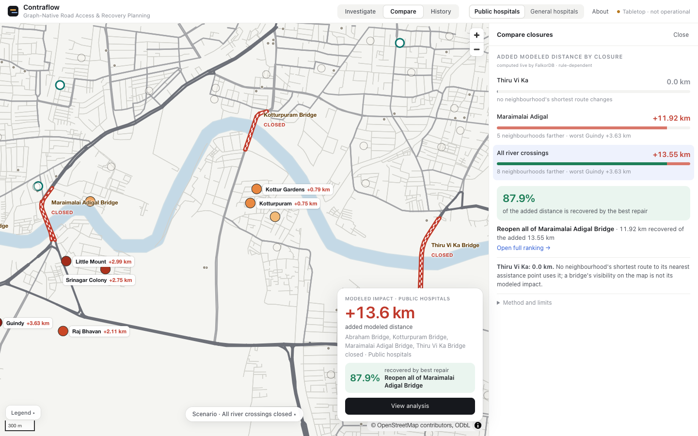
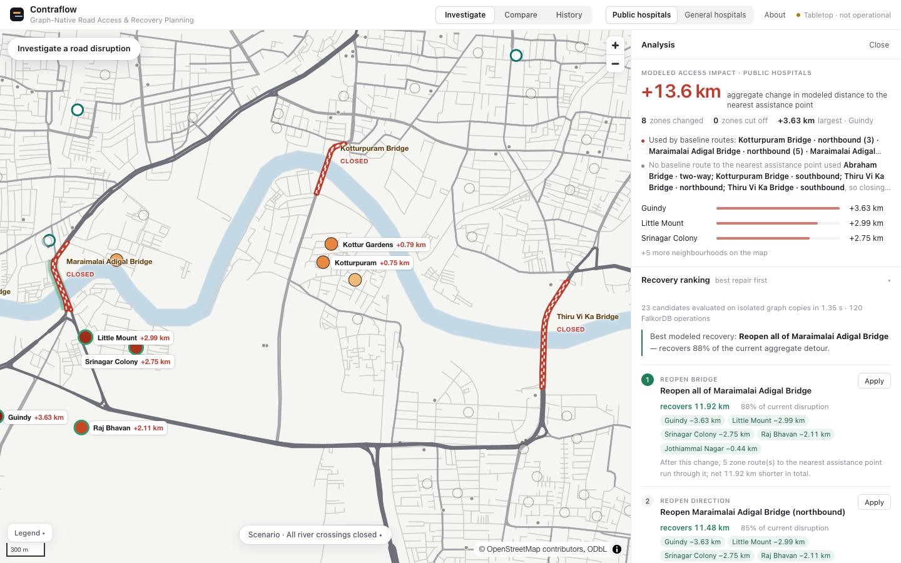
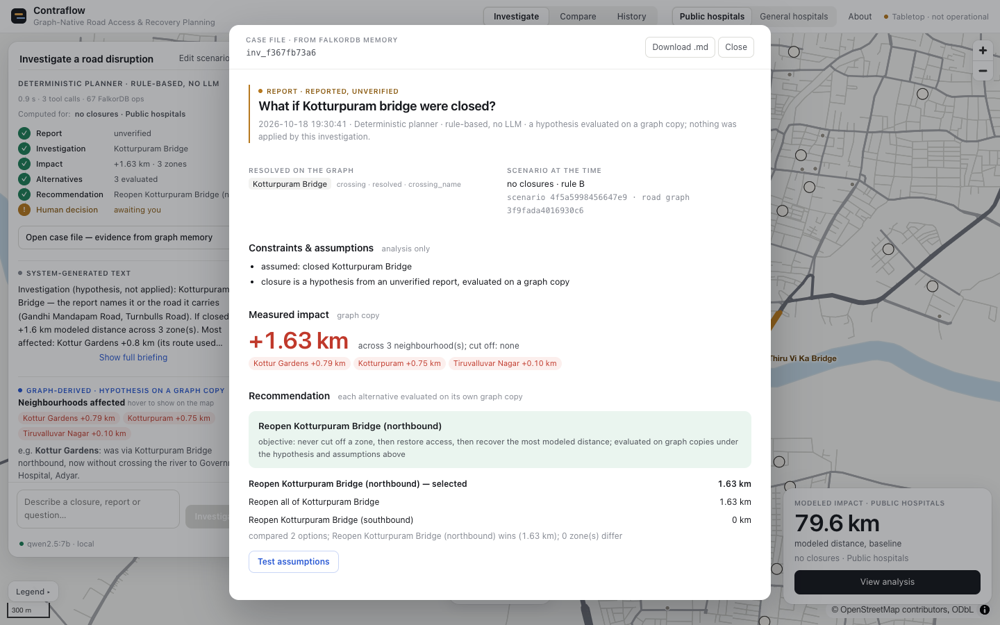
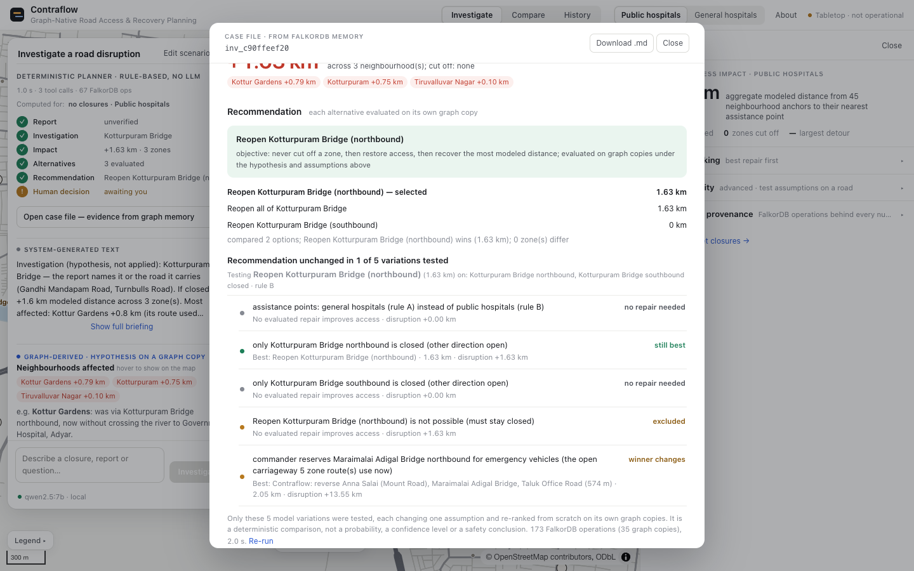

# The Bridge That Didn't Matter

*Building a road-recovery planning agent on FalkorDB, for Graph Hacks 2026 (WeMakeDevs × FalkorDB)*

When roads become unavailable, which connections should be restored first?

To test that question I used the road network around the Adyar river in Chennai and two well-known crossings. One result went against my intuition:

| Modeled scenario (rule B: 4 public hospitals) | Added access distance |
|---|---|
| Close **Thiru Vi Ka Bridge** | **+0.0 km** |
| Close **Maraimalai Adigal Bridge** (Saidapet) | **+11.92 km**, 5 neighbourhoods; Guindy alone +3.63 km |
| Close **all four bridges** (7 directed carriageways) | **+13.55 km**, 8 neighbourhoods, none cut off |
| Then reopen only Maraimalai Adigal | recovers **11.92 km, 87.9%** of the added distance |

Closing the large bridge did nothing to this metric. Closing a bridge I would not have picked first accounted for most of the damage.

These numbers come from the recorded run in `results/demo_run.json`. Before going further, here is exactly what they mean.

## What the number is, and what it isn't

**The metric:** for each of 45 neighbourhood anchors, take the **shortest directed road distance** to the nearest "assistance point", then sum the results. Neighbourhoods that lose access completely are listed separately and never folded into the sum.

**Assistance points** follow one of two rules, both declared before I saw any results:
- **Rule B:** 4 public hospitals (Government / Corporation / ESI / Health-centre names).
- **Rule A:** 37 general hospitals.

Under rule A, Maraimalai Adigal still dominates with smaller numbers: closing all crossings adds +6.69 km, all of it recovered by reopening that one bridge.

**"Thiru Vi Ka: 0 km"** means only that no anchor's shortest route to its nearest public hospital crossed that bridge. It does not mean the bridge is unimportant.

The model does not include travel time, congestion, lane capacity, flood depth, population or hospital capability. Closures and reports are user-entered scenario inputs (synthetic in the demo), not observed events. **Contraflow is a tabletop sandbox and not an emergency tool**, and the app says so on every screen.


*All crossings closed. Closed carriageways are red, the blue line is Guindy's detour, and each label is a neighbourhood's added modeled distance. Map data © OpenStreetMap contributors.*

## The first idea failed, and that was useful

The original plan was more ambitious: an evacuation simulation built on **maximum flow**, i.e. how much traffic the network could push out of a flooded area.

Before building anything I set a hard rule: no feature work until the core algorithm passes independent correctness checks.

Every `algo.maxFlow` result was paired with a certificate (a min-cut reconstructed in the database from the residual graph) and cross-checked against NetworkX. What the checks found:
- All 10 hand-built fixtures passed.
- On random graphs, a small fraction disagreed: 1 of 382 single-source/single-sink graphs, and 4 of 300 multi-terminal graphs.
- The smallest disagreement was a **13-edge graph** where FalkorDB returned 2,550 and the true maximum is 2,700. You can verify the 2,700 by hand from three explicit paths.
- It reproduced on all four builds tested (6.0.2, v4.22.0, and two edge builds).

I want to be careful about what this shows. It is a narrow, reproducible disagreement in one procedure, on the builds tested in October 2026. It is not evidence that FalkorDB is generally unreliable. The script that reproduces it is in the repo (`feasibility/falkordb_maxflow_bug_repro.py`).

For a demo it still mattered: every what-if is a fresh solve on thousands of edges, so a rare error becomes a likely one. I accepted the NO-GO on day one.

**The redesign** asks a smaller question that can be fully verified: who gets farther from help, by how much, and which repair recovers the most?

It is built on two FalkorDB features that passed every check: **directed shortest paths** and **graph cloning**. The routing test suite compares FalkorDB with NetworkX across **1,704 checks with 0 mismatches**. During feasibility, a further 3,266 OSM scenario checks were run the same way.

## The road graph

The data is an OpenStreetMap extract (© OpenStreetMap contributors, **ODbL 1.0**), fetched with OSMnx on 2026-10-15 for the bounding box 80.215, 12.995 – 80.275, 13.035.

**Graph schema:**
```
(:J {id, x, y})                                       3,483 junctions
(:J)-[:ROAD {eid, len, name, oneway, crossing}]->(:J)  8,458 directed segments (788 one-way)
(:Zone)-[:ANCHORED_AT]->(:J)                          45 neighbourhood anchors
(:Help)-[:ANCHORED_AT]->(:J)                          40 hospitals, tagged rule A and/or B
(:Crossing)-[:HAS_CARRIAGEWAY]->(:Carriageway)        4 bridges, 7 directed carriageways
(:Zone)-[:NEAR {m}]->(:Crossing)                      for resolving field reports
```

Two-way roads are two arcs, and OSM one-way tags are respected. River crossings are not hand-picked: they are the segments whose geometry intersects the OSM Adyar River line, grouped into directed carriageways, so "Maraimalai Adigal northbound" can close on its own. Anchors snap inside the largest strongly connected component; Velachery is excluded because its place point lies 1.9 km outside the extract.

## Why the graph database does the work

**Nearest of many, for all 45 neighbourhoods, in one query.** Each assistance rule gets a virtual hub node. Every hospital's junction connects to it with a zero-length edge, so "shortest path to the hub" means "shortest path to the nearest hospital". This is the production query (`contraflow/engine.py`):

```cypher
MATCH (z:Zone)-[:ANCHORED_AT]->(a:J), (h:J {id: $hub})
CALL algo.SPpaths({sourceNode: a, targetNode: h, relTypes: ['ROAD'], weightProp: 'len'})
YIELD path, pathWeight
WITH z, pathWeight, relationships(path) AS rs
RETURN z.id, pathWeight, [r IN rs WHERE NOT coalesce(r.virtual, false) | r.eid], startNode(rs[size(rs) - 1]).id
```

The query returns the edge ids along each route. Those ids power the explanations ("the northbound carriageway carried 5 baseline routes"). A zone missing from the result has no directed route.

**Every what-if runs on a copy.** The base graph is never mutated. Each scenario does this:

```
GRAPH.COPY contraflow cf_sc_<id>
UNWIND $ids AS i MATCH ()-[e:ROAD {eid: i}]->() DELETE e   -- closures, in the copy
... access query ...
GRAPH.DELETE cf_sc_<id>
```

**Ranking repairs uses the same pattern.** Each candidate gets its own copy:
- **Candidates:** reopening a carriageway or a bridge, or reversing a one-way street.
- **Where contraflow candidates come from:** routing with `relDirection: 'both'` and collecting one-way arcs that the path uses backwards.
- **Objective, in strict order:** never cut a neighbourhood off; then restore access; then recover the most distance.

On an Apple M4 laptop with FalkorDB 6.0.2, measured medians were:

| Operation | Median |
|---|---|
| Access query for all 45 zones | 9.4 ms |
| Copy + delete | 32 ms |
| Ranking all 23 candidates (120 database operations) | 1.12 s |


*Compare shows the preset closures side by side, with modeled distance and the best repair computed by FalkorDB.*


*The recovery ranking. Each candidate is evaluated on its own graph copy, and the beneficiaries are listed per neighbourhood.*

## The agent, and who is responsible for what

The planning agent turns messages like *"A volunteer says Kotturpuram bridge may be blocked by fallen trees. Who would need a detour, keeping Maraimalai Adigal southbound reserved for ambulances?"* into a graph-backed investigation.

Responsibilities are split deliberately:

- **Qwen 2.5 7B** (local, via Ollama) chooses tools through function calling. It is offered only the tools that match the parsed intent, so an investigation never sees a proposal tool.
- **Deterministic code** parses the message once into a typed action (operation, polarity, direction, plus a separate constraint clause). Every tool call is validated against that action. If the model stops early, the runtime finishes the investigation chain and labels that it did so.
- **FalkorDB** produces every number. The briefing is composed from tool outputs. A numeric check confirms each figure appears in those outputs, but that check is not semantic verification, so the model's own wording is shown separately and marked unverified.
- **A human** decides. Nothing is applied until someone clicks Apply. The server then re-derives the candidate from the current scenario and re-checks every constraint. It ignores any result the client sends.

For that message, the agent's answer was:
- **Impact:** closing Kotturpuram adds +1.63 km across 3 neighbourhoods.
- **With the reservation:** holding Maraimalai Adigal southbound for ambulances brings the total to +2.08 km.
- **Recommendation:** "Reopen Kotturpuram Bridge (northbound)".
- **Status:** awaiting a human decision.

**Getting the scope right was the hard part.** The message names two bridges and two directions. An external review (run with OpenAI Codex) caught an earlier build making two mistakes:
- It investigated Kotturpuram **southbound only**, because the word "southbound" leaked across clauses.
- It reserved **both** directions of Maraimalai Adigal.

The closure was reported as 0 km instead of +1.63 km, and the top repair came out as a one-way reversal on Velachery Main Road instead of reopening Kotturpuram northbound. Now each clause carries its own typed scope, and the tool layer rejects any call whose target or direction differs from what the user wrote.

## Memory that can go stale

Every investigation is stored in a separate FalkorDB graph. It is also appended to a journal, which is replayed into an empty graph at start-up. Recall is by place, not by text similarity:

```cypher
MATCH (f:Finding)-[:CONCERNS|AFFECTS]->(p:Place) WHERE p.id IN $ids
MATCH (f)-[:IN]->(i:Investigation) ...
```

The key design choice is that **a recalled finding is never trusted as stored**. Each finding is re-applied to the scenario on screen:
- **Impact findings:** the stored hypothesis is re-evaluated. If its closure is already applied, the finding is marked **superseded**.
- **Rankings:** if the ranking was computed for a different scenario, it is marked **stale: re-rank before relying on it**.

The project exposes seven read-only tools over a small MCP server. I checked how they work from a real Claude Code client:

- **Tool calls (fresh Claude Code desktop session):** I asked the session to call `rank_repairs` and `recall_investigations`. With all four crossings closed, it returned the same ranking as the app: Maraimalai Adigal first, 11.92 km, 87.9%.
- **Recall result:** it returned two Kotturpuram findings from a seeded test investigation. The ranking was labelled **stale** and the impact estimate **superseded (closure now applied)**. That is correct, because Kotturpuram was now one of the four closed bridges.
- **Tool discovery (separate headless Claude Code 2.1.286 run):** the client listed the six tools that existed then. It made no calls, because that environment had no model access.
- **Everything else** (the other five tools, including `test_recommendation` and `get_case_file`, and the refusal of a mutating tool) was exercised only by the project's own JSON-RPC test client over stdio.


*A case file is one multi-hop traversal of the memory graph. Note step 1: the model's first tool call was rejected for a bad argument, and the file keeps that.*

## An agent that questions its own recommendation

The last feature added asks: *does this recommendation survive if an assumption changes?*

**Test assumptions** re-ranks the case's recommendation under up to five variations. Each variation changes exactly one field of the scenario:
- the other hospital rule;
- one closure direction only;
- the recommended repair forbidden;
- an extra emergency reservation on the busiest open carriageway.

Every variation is a full re-ranking on graph copies.

**Example:**
- **Base case:** Kotturpuram closed. The recommendation is to reopen its northbound carriageway.
- **Changed assumption:** Maraimalai Adigal northbound is also reserved, the carriageway that five neighbourhood routes use.
- **Result:** the winner changes to a contraflow option, reversing a 574 m stretch near Anna Salai, Maraimalai Adigal and Taluk Office Road. It recovers 2.05 km, mostly for Guindy, Little Mount and Srinagar Colony.

**The ambulance report:**
- The recommendation held in only 2 of 5 variations.
- If only the *southbound* carriageway is blocked, the closure adds just +0.44 km (instead of +2.08 km), and no tested repair improves on it.
- So the direction of the blockage is the fact to verify first.

"Holds in 2 of 5 tested variations" is a count over a few rule-chosen model changes, not a probability, a confidence level or a safety claim, and the UI says so. It also takes 3–9 s.


*The Kotturpuram example holds in 1 of 5 variations. Each row changes one assumption and is re-ranked from scratch on FalkorDB graph copies.*

## What failed, and what I learned

- **Max-flow and scope leakage** (above): verify before building, and enforce scope in code rather than prompts.
- **A harmful option looked harmless.** Scoring once summed distance only over zones connected before *and* after, so a reversal that cut Little Mount off entirely showed as "no change". Losses now rank last and are labelled harmful.
- **Late responses overwrote newer state.** A slow Apply could revert a rule change the user had just made. Responses are now discarded if the user has acted since.
- **Trust boundaries:** an early apply endpoint trusted a result the client sent. It now accepts only a candidate id plus the scenario key, and recomputes everything on the server.
- **Latency:** live Qwen replies took roughly 5–35 s (median 16 s in the benchmark). A rule-based planner answers in about 1 s, and the UI labels which one answered.
- **Scientific uncertainty:** one metric, one city extract, two declared hospital rules. Everything here is a modeled comparison.

## How it was built

This was a solo entry built with heavy AI assistance.
- **What I did:** chose the problem, set the feasibility gate, accepted the max-flow NO-GO, defined the metric and its limits, and decided what to ship.
- **What Claude Code did:** wrote the implementation, tests and experiments, and ran them under my direction.
- **External review:** OpenAI Codex audited the project several times. Each finding was reproduced, fixed and covered by a regression test.
- **Test suite:** 327 tests passed at the time of the last feature, including live-model and real-browser tests. Full disclosure is in `docs/AI_DISCLOSURE.md`.

The lesson I'll keep: the graph was most useful when it showed that the obvious answer was wrong, and the agent was most useful when it pointed out what I still needed to verify.

---

**Links**
- Code: {{GITHUB_REPO_URL}}
- Live app: {{LIVE_APP_URL}}
- Demo video: {{DEMO_VIDEO_URL}}
- FalkorDB docs: https://docs.falkordb.com/ · algorithms: https://docs.falkordb.com/algorithms/
- Graph Hacks 2026: https://www.wemakedevs.org/hackathons/falkordb
- Map data © OpenStreetMap contributors, ODbL 1.0: https://www.openstreetmap.org/copyright
